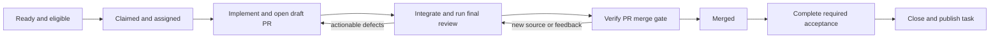

# Herdr orchestration skill design

Use one coordinator to maintain the delivery scope and policy, with task drivers able to advance their assigned work through implementation, review, merge, and acceptance without waiting for a supervision tick. Work runs in isolated Herdr worktrees with GitHub PRs and either Beads Rust (`br`) or Beadroll (`bead`). Reuse the review-fix controller. Authorized per-host execution slots govern parallelism; an optional run-level cap limits admitted unfinished tasks. The coordinator does not impose another generic build/test queue.

This is the second shaping revision, amended after the Claude Fable 5.1 adversarial review and subsequent user decisions on 11 October 2026, for `herdr-orchestrate` in a `jig-orchestration` plugin. Implementation was authorized after the installation contract below was agreed. This design does not change the live source workflow or authorize changing that thread's existing pinned reviews.

## What the source thread demonstrated

The source is thread `01a117b0-3e3e-7c93-a538-c8d2eb781cb1`, “Review unblocked increment delivery,” on `dev@bpcakes-dev-01`. Its rollout is:

```text
/srv/dev/home/dev/.codex-featherenvy/sessions/2026/10/07/rollout-2026-10-07T18-46-28-01a117b0-3e3e-7c93-a538-c8d2eb781cb1.jsonl
```

The first inspection covered 7–9 October 2026 through L11242. The second snapshot extends through L29564 at 11 October 09:24 UTC; the entire earlier snapshot is an identical prefix. Seven later records are truncated and were excluded from interpretation: L15009, L21641, L21771, L22143, L22151, L23013, and L24257. `L` references are original JSONL record lines, not rendered transcript lines. These are historical observations, not claims about the current PRs.

The workflow grew from individual task launches into a persistent supervisor. Claude implemented a specified task and ran its own pinned-range Codex review loop. The supervisor checked for a PR and green CI, launched a fresh Codex review-fix session, checked final evidence, and merged. It selected newly available work from Beads, reconciled main, coordinated staging, and saved instructions and state outside the repository. The user changed capacity to three local plus two remote streams and reduced the check interval from 30 to 20 minutes.

Several adaptations worked well: a timer woke the existing supervisor rather than keeping a model polling; worktrees isolated implementation; final merge checks compared controller evidence with the actual PR head; dirty tracker updates were preserved during reconciliation; hosted acceptance remained distinguishable from merged implementation. The sampled PR #93 merge has controller, CI, head-pinned merge, and resulting merge evidence at L610, L617, L623, and L633. The audit did not find a stale-head merge in that sample.

| Weakness observed | Evidence and consequence | Design response |
| --- | --- | --- |
| The initial merge gate omitted external PR feedback. | The user noticed connector comments at L1879–1911. The retrospective inspection confirmed residual issues in merged #93/#96 and misleading acceptance language in #99: L1957, L1960, L1972. | Reconcile actionable inline comments, review bodies, and issue comments before every merge, including outdated/resolved threads. |
| Agent location and ownership were implicit. | A remote reviewer reported sending two prompts to a user-owned main-checkout agent and waiting for it, L9134. The supervisor also used remote main; the user imposed a worktree-only boundary at L9046–9064. No destructive overwrite was established. | Explicit host, session, agent, checkout, and supervisor return route; operate only within registered locations. |
| Tracker snapshots disagreed across machines. | Triage described already-running remote tasks as unclaimed at L452; the supervisor correctly avoided duplicates. A new worktree's export was stale at L4749, and remote decision comments were missing at L9115. | One selected tracker authority, explicit freshness, and confirmed ownership before dispatch. |
| Five occupied streams were not five runnable streams. | Team's ready review was queued at 01:31 and still queued at 06:54 on 9 October: L6011, L7504. Concurrent heavy work exhausted disk: L5625 and later L10112. Local and remote review-controller versions had different lock scopes: L3660–3671, L7864. | Discover actual tool limits and fix concrete capacity problems. The second inspection below overturns the first design's default additional heavy-work grants. |
| Keeping main current inflated immutable review ranges. | A review could not complete a 780-path range within an hour, L2266. Team later had a 396-path range with a five-minute budget, L11116. A Documents worker excluded main-imported changes without authorization, admitted the error, and reran the full range, L6609. | Integrate before final review, fix the base for that run, and disclose any subsequent new review scope. Size review admission to the actual diff. |
| Persistence became expensive to read. | Full instruction and broad state reads were visibly truncated, L10019, L10029, L10410. Retrieved instructions were 129,272 bytes; state was 993,430 bytes. Later selective reads mitigated this; the entire state was not read on every tick. | Keep current rules and compact current state separate from historical evidence; return changes and evidence references. |
| Historical setup notes became stale blockers. | A live preflight found messaging custody already deployed and removed four supposed setup steps, L2928; actual Auth deployment and recipient verification still remained. | Store blocker predicates with observation times and verify uncertain prerequisites before escalating them. |
| Review continuation and cleanup were too easy to prolong. | One worker admitted twice calling an orphan-intake repair fixed before the required behavior was fixed, L2537. Hosted cleanup lacked published identifiers at L1043 and held downstream work. | Carry cumulative repair budgets, verify behavior, and retain resource ownership until cleanup or containment is established. |
| Merge completion and tracker completion diverged. | The user explicitly added post-merge closure at L2695. Later an epic with seven closed children and merged acceptance evidence stayed open until the user asked: L10927, L10981, L11013. | Make post-merge acceptance, tracker publication, and parent reconciliation part of the lifecycle. |

These incidents do not establish that every delay was waste. Real defects, unavailable prerequisites, and incomplete reviews appropriately prevented delivery. The skill should remove avoidable queueing and repeated discovery while retaining those checks.

## What the extended run changed

The run expanded to four machines, then switched to finishing its existing batch. It eventually merged Document delivery #112 and closed its task as `accepted:local` under the recorded task contract, while separately scoped hosted work remained open (L23863–24026). Co-borrower #102 also merged; direct verification checked its exact review/merge tree and 22 required checks, while hosted acceptance remained incomplete (L28541–28545). At the final snapshot, Finance #134 had merged and its hosted journey was running; five supervised tasks remained open, with Team #108 still validating (L29527–29561).

| New evidence | Revision to the first design |
| --- | --- |
| The user rejected supervisor-added resource queues at L20513. A trace build had even waited because 12.385 GiB fell below a 12.4 GiB estimate (L20520). Revocation reached nine owners and independent work resumed, L20563–20624. | Remove default heavy-test grants, footprint admission thresholds, and added CPU/memory partitions. Preserve slot limits, actual tool locks, checkout ownership, and shared-environment safety. |
| Conditional merge and direct handoff authority advanced PR127 and later PR128/132 without waiting for a tick, L20740–20896, L24486, L25997. | The coordinator owns policy; a registered task driver can execute its gates and merge. Supervision reconciles the result instead of becoming a required extra gate. |
| PR112 used all six source-repair rounds, then converged at round zero in a fresh verification run, L21961, L23863. At L29275 the supervisor correctly distinguished its own three-round default from user authority to finish a necessary fix. | Separate hard user limits from controller run limits and source repair from verification. Do not convert a default into an invented permission requirement. |
| A worker handoff appeared as a user message and claimed user authorization; the coordinator misread its origin, then acknowledged the mistake, L20801–20841. No unauthorized design approval was established. | Correlate worker updates with dispatches and observed worker state. Text labels do not authenticate origin; a worker's claim about the user does not amend authority. |
| The timer disappeared. Its last successful automatic prompt was at 13:50; its log ended partly written at 15:10. The user noticed at 21:50, L25757–25784. Supervised restart and duplicate-instance tests passed, L25866; an actual later tick fired, L25913–25957. Disk failure is a plausible cause, not proven by a traceback. | Scheduling needs observed health and recoverable execution, with attempted/delivered/completed wakeups distinguished. A planned timestamp is not evidence that supervision will run. |
| The user stopped new admissions, rejected unrelated backlog counts, excluded other worktrees, and repeatedly asked whether hosted work was actually running, L18561–18599, L20419, L24419, L26036. | Freeze an explicit current batch; keep completion reporting and cleanup inside it. Choose hosted work dynamically from ready tasks, distinguishing preparation from execution. |
| Session replacements encountered still-running background validation and unnamed replacement agents, L22820–22868. PR108 later moved to Pop at a settled revision, L23202–23314. | Separate task, session, controller, and execution identities. Restarting a model session is not permission to restart jobs or duplicate a task. Relocation is an explicit handoff. |
| The inspection helper accepted a run ID but then selected the newest sibling `run.json` by modification time, L28521. It later returned PR129's historical proof while checking PR134; the supervisor rejected it, L29176/L29209. | Bind observations to the registered run ID or an explicit successor link. This caused stale attribution; no incorrect merge was established. |

The earlier review-scope problem persisted: PR102's cumulative review was reported as 1,422 paths (L24930–24999). The new snapshot also contains 570,362 bytes of instructions and 3,087,298 bytes of state, with 239 top-level state fields. These observations strengthen the existing decisions to review an explicit integration range and keep current state separate from history; they do not justify another process layer.

## Scope and authority

The skill handles a named task set or epic in one repository across registered Herdr hosts. One coordinator is responsible for the run. Worker sessions implement one assigned task; the coordinator selects subsequent work. Pre-existing workers can be adopted only after their owner, scope, checkout, and existing review state are reconciled.

Support continuing admission and **finish-current** operation. On “stop admitting and finish the work in progress,” record the exact admitted unfinished task IDs and stop new task admission. Parked tasks in that frozen batch may acquire freed execution slots and resume. Necessary repairs and prerequisite PRs for those tasks stay in scope; unrelated backlog work does not. A separately authorized extra slot has a named purpose and retirement condition and does not reopen general admission. Discovery of other agents, worktrees, or PRs does not adopt them. An excluded task stays outside supervision and cleanup unless a later direct instruction explicitly reintroduces a specific action.

At startup, resolve the repository's actual target branch, tracker, task scope, hosts, worktree locations, worker models, review policy, capacity, and completion criteria. Reuse explicit choices already in the conversation and repository. Record existing authority for pushes, PRs, merges, deployment, and scheduled supervision. A missing deployment authorization does not prevent authorized coding and review. Pause only the dependent action; do not repeatedly ask for an authorization already granted.

Preserve the selected native approval settings when launching workers; task authorization does not waive a tool's approval control. If a worker is blocked at an approval dialog, inspect and report the exact pane, requested action, and required native response. The coordinator never answers another agent's approval UI by key injection, changes its permission mode to escape the dialog, or repeats the underlying task-authorization question. Keep the blocker until the native response is observed; independent work continues.

Main working trees and their panes/agents are outside the registered work area by default. Linked worktrees share Git metadata: access it through supported Git/controller operations from an allowed worktree, without inspecting the main working tree. Use a dedicated coordinator worktree for source/tracker inspection when needed. A pre-existing tracker elsewhere may require explicit database access or supported redirection; resolve that boundary before access.

Task-specific holds survive general “continue” instructions. A changed acceptance decision is recorded with its source, propagated to affected workers, and assessed for its effect on existing review evidence. Neither a worker nor the coordinator may invent a product decision to dismiss a finding.

Herdr prompts can arrive as ordinary user-role text without authenticated sender metadata. Require worker replies to carry host/session, task, dispatch action ID, and evidence references; correlate them with the action log and corroborate consequential claims through the registered worker's pane or durable output. Headers alone establish no authority. Process ordinary direct user turns as instructions; absence of a worker header alone does not require clarification. When worker correlation, a third-party claim of user permission, or conflicting origin evidence makes an authority change ambiguous, retain current authority and clarify that change once. Do not reconfirm established authorization. Reject accidental prompts to the sending worker itself; legitimate replies to the coordinator remain valid.

Herdr control follows its managed-session check. Identify the actual session endpoint on each registered host through the installed CLI's supported connection mechanism. Do not substitute the focused session, infer a supervisor from its checkout, or manufacture environment variables to bypass the managed-session check.

I1 binds each endpoint before dispatch. For local API commands, use the registered `--session <name>` where supported. For remote commands, prefer installed `--machine <profile-id>` forwarding and register the profile's SSH target and remote session; do not combine it with `--session` or `--remote`. If unavailable, verify an SSH-wrapped remote CLI invocation with an explicit session from the managed coordinator. Capture installed help and prove get/prompt/read/wait against owned test agents. Bind returned IDs to their endpoint and native agent identity; profile/session changes require rebinding. Never reuse local `--current` context remotely. Named-session addressing does not waive the managed-pane guard. A host with neither verified connection is excluded from remote dispatch.

This is an orchestration skill, not a planning or migration framework. It does not automatically add trackers, migrate Beads to Beadroll, redesign tasks, change model choices, deploy infrastructure, or replace unavailable tools. Detect an unsupported capability before admitting work that needs it; other independent work can continue.

### Installation across machines

Install the skills and runtimes each host's assigned roles use in the actual agent homes/profiles selected for that host. The coordinator needs the orchestration skill/helper. Implementation workers need their task-specific skills; hosts running review/repair need the matching `review-fix-loop` and `comprehensive-review` pair and its runtimes. These review skills currently run under Codex, with Claude supported as an external reviewer or implementation worker. A coordinator installation is not inherited over SSH, and installing in the default Codex home does not provision other `CODEX_HOME` profiles. The full skill catalog is unnecessary.

Preflight verifies selected profiles, installed skill paths and compatible versions, runtimes, reviewer authentication, and role-specific capabilities on each host. One coordinator retains authoritative state and the scheduler. Existing runs retain their working skill/controller runtimes; missing dependencies produce a concrete setup report. Installation and upgrades are separate setup operations, never silent side effects of admitting work. The installer/catalog must expose the new plugin and preserve its review dependencies without overwriting incompatible automatic dependencies.

## Work controls

Keep admission policy, execution pause, and scheduler state separate. Support these explicit instructions for the run, with pause/cancellation also applicable to named tasks:

| Instruction | Behavior |
| --- | --- |
| Finish current; admit nothing new | Freeze the admitted task set as above. Existing tasks may resume, repair, review, merge, and complete acceptance. |
| Pause | Prevent new work stages and consequential transitions. Already-started executions settle at their supported stopping boundary; observation and status reporting continue. |
| Cancel active executions | Pause affected work and request termination of its registered workers, controllers, reviewer children, and background jobs through supported controls. Verify which executions stopped before releasing capacity. |

A bare “stop” means pause unless the instruction explicitly requests cancellation. Record the control and its scope through the helper under a new policy revision, and report remaining executions and their stopping boundaries immediately. Fence new action authorizations; a stale delegation or slot reservation does not permit a new launch. I1 records the actual worker/controller pause boundary and cancellation capability. An implementation assignment or review round may be the smallest supported unit: do not promise tool-by-tool suspension. Report pausing or cancellation unconfirmed while settlement or acknowledgement is outstanding. Already-issued actions, including a merge, may complete after the request; reconcile their result rather than claim rollback or replay them.

Cancellation preserves unfinished tasks, claims, worktrees, findings, evidence, and resource obligations. It does not close tasks, delete worktrees, undo merges, or automatically release staging. An unreachable host retains its execution slots until settlement is verified. Necessary bounded settlement and receipt recording remain available; they do not authorize another repair, review, merge, or deployment.

Resume clears the selected orchestration pause and preserves the existing admission policy, task-specific holds, limits, findings, and ownership. It does not reopen frozen admissions or automatically restart cancelled jobs. Reconcile surviving executions and uncertain outcomes first; a new attempt requires a slot and remaining authority. Pausing or cancelling work keeps supervision running. Stopping the supervision mechanism is a separate explicit operation and does not itself stop workers.

## Ownership and state

Keep the responsibilities distinct:

| Owner | Responsibility |
| --- | --- |
| Tracker | Canonical task requirements, dependencies, claims, decisions, and completion status. |
| Coordinator | Current batch, authority, task admission/assignment, dependency decisions, delegation, and delivery reconciliation. |
| Task worker | Assigned source changes, focused checks, coherent commits, draft PR, and implementation handoff. |
| Task driver | The named worker or review-session parent responsible for progressing that task and executing any delegated PR gates/merge/handoffs. Read-only reviewer children receive no mutation authority. |
| Review-fix controller | Review scope, findings, repairs, validation, convergence, and its own cleanup. |
| GitHub | Actual PR head, target, checks, feedback, and merge result. |
| Acceptance owner | Authorized deployment, environment-specific behavioral proof, and cleanup. This can be the task worker. |

The coordinator owns tracker transitions for newly admitted tasks. For an adopted task, retain its established claim owner until an explicit, acknowledged handoff. If that owner is definitively stopped, a supported takeover may replace the handoff when task authority covers recovery; record the observed termination and reason. Network silence alone is not termination. In Beadroll, a coordinator can use a recorded stable run actor on its designated machine; worker identities remain separate. Do not force-close another actor's claim. A supervisor failover to another machine requires supported ownership reconciliation, not reuse of a copied machine identity.

Maintain one private run directory outside source control:

- A compact current configuration: repository, authority and policy revision, tracker binding, current batch/admission mode, registered hosts/paths, per-host execution-slot limits, optional run-level unfinished-task cap, review policy including reviewer fanout, configured limits/checkpoints with units, scopes, enforcement capabilities and exhaustion behavior, cadence, holds, and any authorized notification destination.
- An atomically replaced current-state file: each task's admission and parked/executing state, pause/cancellation request and observed settlement, execution-slot reservation, phase, owner/driver, host/session/profile identity, worktree/branch, PR and exact controller/run/active-job references, original task base, review base/head, delegation, cumulative attempt/repair reservations and counts, available usage receipts and missing coverage, carried-finding references/dispositions, staging ownership, blocker, and next action. Preserve run-level controls separately from scheduler state. A blocker names a predicate, evidence source, observation time, and next verification/action; unknown or historical information is not a currently observed failure.
- A small append-only action log with intent, delivery acknowledgement, and observed result, plus links to existing controller and GitHub evidence. Archive settled history; do not embed full controller reports in current state.

The helper on the coordinator host is the sole writer of orchestration state. Coordinator decisions and authorized worker requests use its short, locked transitions with expected policy/task versions. Drivers retain results in GitHub/controller/acceptance artifacts and submit action IDs plus evidence references, rather than editing current state. No lock spans a model turn or external execution. Run only one reconciliation pass at a time and recheck versions when applying its observations. V1 has no automatic cross-host coordinator failover: workers retain assignments, and a replacement must establish that its predecessor stopped and reconcile unfinished actions.

Coordinator-to-worker access does not prove a return route. I1 separately registers and probes each worker host's SSH route to the coordinator, caller identity, and allowed helper commands. I2 verifies remote query/transition calls against isolated state. This route allows only assigned state operations, never Herdr dispatch or arbitrary commands. Hosts without it use coordinator-mediated consequential transitions: workers leave durable handoffs for inspection, and the coordinator executes merge gates/staging transfers and records results. Do not promise driver-direct transitions on those hosts or invent a transport; implementation/review can still run there. Record this capability at admission.

Before a side effect, persist its action ID and expected target identity. After a timeout or restart, query the resulting worker, PR, tracker, or controller state before retrying. An uncertain prompt, claim, merge, or deployment is not permission to replay it. Coalesce wake-ups while the coordinator is busy. An expired timer does not release a task claim, staging grant, or worker identity.

Follow registered controller/run IDs. Discover a successor only through a recorded handoff or verified controller relationship, never through latest modification time, latest filename, or a pane's “done” badge. A missing or mismatched record makes that observation unknown; it does not replace the current record with a nearby successful one.

For an authorized session restart, first inspect the actual pane occupant, existing jobs, native reviewer handles, unsent input, and saved handoff. Adopt an already-created replacement if appropriate; do not launch a duplicate. Rebind the session/profile identity while keeping task ownership, source revision, controller run, outstanding executions, evidence, and consumed work intact. Use supported recovery for the existing run. A restart must not erase a tool denial or evade an approval control.

## Tracker bindings

Support two concrete bindings initially; select one from repository instructions/configuration, not whichever executable or `.beads` directory is present. `bd` requires a separately verified binding before support is claimed.

| Concern | Beads Rust `br` | Python Beadroll `bead` |
| --- | --- | --- |
| Authority | One configured canonical tracker/store for the run. Route cross-host claims and closure through that authority. Independent clone databases are not a distributed lock. | The repository's existing workspace and coordination ref. Retain the native claim protocol; no additional distributed claim database. |
| Refresh | Use the repository's supported import/export reconciliation. Preserve local records and inspect conflicts. Updating code alone does not prove tracker freshness. | `bead sync` before admission/closure reconciliation; `ready`, `show`, and other reads are local and do not refresh themselves. |
| Claim | Serialize claims at the configured authority, re-read blockers/assignment, claim through its supported CLI, and read back the durable owner. I1 defines its exact confirmation/publication receipt under repository policy. All orchestrated writers use this authority; Git export alone is not a lock. | Require a confirmed online claim. An offline provisional claim or an unresolved attempt does not admit work. Reconcile through `sync`; do not force takeover based on silence. |
| Readiness | Graph triage such as `bv` ranks candidates; it does not reserve them. Re-read after claim before implementation. | Likewise recheck blockers and acceptance prerequisites: the inspected Python claim implementation enforces ownership but does not itself check graph blockers. |
| Publication | Flush and publish task metadata according to repository policy. Keep unrelated changes intact. | Check the structured `unpublished` result. A locally recorded close is not proof that other machines received it. |
| Exports | Never hand-edit JSONL to manufacture status or resolve claims. | Beads JSONL is interchange/history, not the live store. Do not run `br` against a leftover export. |

Beadroll evidence from the first shaping pass: the README, migration guide, and Python `commands.py`/`cli.py` in `aa@torque.local:Documents/beadroll`, clean at commit `f15f35bedd3a10dfe8eb5965796e901a2d690e6b`; local `bead --version` then reported `0.1.0`. Its online claims persist until release, close, or takeover, and writes may be recorded locally while publication remains pending. The Rust rewrite does not need to finish before this binding is useful. Match supported CLI behavior at runtime rather than depending on its implementation language; this round did not re-audit Beadroll's current version.

## Lifecycle



Blocked and held are overlays on a phase, with the concrete dependency and next action. A merged task can remain incomplete. A done/idle Herdr indicator means the agent is available; it does not advance the task lifecycle.

One task may require several PRs. Repeat the PR portion without losing task ownership or outstanding acceptance criteria. Closure reconciles all required changes and the final combined behavior. If fresh evidence contradicts that task's acceptance, reopen it under the same scope/owner, correct current acceptance labels, preserve historical proof, and publish the transition; this worked for the main-CI regression at L19914–20017. An externally merged PR with missing review evidence is an assurance gap, not retroactive convergence: review the relevant pinned source, deliver any necessary repair through a gated PR, and disclose the original gap. Green CI on another PR does not fill it.

1. **Admit:** refresh source and tracker evidence; inspect readiness, real acceptance prerequisites, current assignments, resource pressure, and PRs. Confirm the claim before dispatch. Prefer finishing work that unblocks accepted product increments. Do not fill a slot merely because it exists.
2. **Assign:** create an isolated worktree from the chosen target snapshot. Send task ID and acceptance criteria, source decisions, allowed paths, worker role, supervisor return route, relevant checks, commit/PR authority, and expected handoff. Record returned Herdr IDs; never infer them from sidebar order or reuse an agent name as proof of process identity.
3. **Implement:** the worker owns source writes and opens a draft PR once useful commits exist, allowing CI to overlap remaining work. Verify the intended PR target at creation/adoption and resolve blocked corrections early; PR108's retarget denial persisted even after convergence (L27071–27080). Report task, branch/head, checks, PR, unresolved criteria, and resources still held. Do not close before required integration/acceptance or commit unexplained “workflow metadata”; unrelated residual changes remain untouched.
4. **Review:** at a settled worker boundary, integrate the required target snapshot, validate prerequisites, and start the configured independent review-fix workflow. The default has one final review-fix gate rather than both an inner implementation review loop and a second equivalent outer loop. Honor an explicit request for additional reviews.
5. **Merge:** the designated gate executor verifies the gate below against live evidence, performs the authorized merge with an expected-head guard, confirms and records the result, and notifies dependent owners. The coordinator may delegate this to the task driver. Neither actor substitutes a worker's “converged” message for the controller result.
6. **Accept and close:** if the task requires deployed behavior, verify the deployed revision/configuration and the actual signed-in journey, then required cleanup. Close only the criteria that have been met and confirm tracker publication. Reconcile affected parent epics against their own criteria; closed children alone are insufficient.

Each worktree has one source writer at a time. Implementation-to-review and review-to-acceptance handoffs require the prior writer and its descendants to be settled. Preserve failed evidence and use the controller's own supported recovery operations.

A delegated transition names its executor, task/PR, permitted action, gate evidence, policy revision, and hold/cancellation conditions. Before merging or deploying, the executor rechecks current authority/holds and live gates; changed source invalidates the old candidate's evidence. Unavailable current authority prevents that irreversible transition, not unrelated authorized checks. The helper records one pending executor/action ID; the executor saves the resulting receipt and reports it for reconciliation. After uncertain delivery, inspect the external result before retrying. Delegation changes who executes the gate and does not add another full coordinator review.

When a small genuine prerequisite is trapped in a large unfinished PR, assess an independently testable prerequisite PR within the same task scope. Preserve the original task's remaining requirements and prior findings; independently review the extracted change and its eventual integration. Do not call the larger task complete because the prerequisite merged.

## Review scope and merge gate

Record two different facts: the original task base for provenance, and the integrated target base used by a final review run. For that run, review the complete PR diff from its fixed base to the current candidate head, including conflict-resolution effects and every task change. Repairs append commits; they do not move the run's base or narrow its file set.

New final runs explicitly select `--commit-mode per-round` and `--base <recorded-integrated-target-OID>` after a settled, clean implementation handoff; verify the returned fixed base rather than relying on local-branch auto-detection. Task drivers publish the resulting commits; the controller does not push. At merge, its converged `commitRange.tip`, the clean checkout's HEAD, and GitHub's current PR head must agree, with final reports and validation bound to that range/fingerprint. Keep tracker edits outside task checkouts. Preserve an adopted run's pinned mode: `none` requires an explicit mapping from the certified full source/tree to the published commit, including whether Git-aware checks remain applicable. Tree equality alone is insufficient. If the installed interface cannot establish that applicability, settle normally and review/validate the published candidate in a successor; never relabel old evidence or silently change a run's mode.

Fetch observations can occur while a worker runs; source integration waits for a safe boundary in that checkout. Do not repeatedly merge main into a running review merely to make an “up to date” status green. Independent worktrees can integrate, validate, and review concurrently. Coordinate only the shared target update and concrete conflicts, using the repository's merge queue when required; do not add a global integration queue.

If new target changes require integration after a review run has begun, settle the old run normally and start a disclosed new run against the integrated target. Retain the original task base, old scope/results, unresolved findings and decisions, and cumulative repair expenditure. Reconcile prior findings in triage without feeding previous verdicts into independent reviewer inputs. The new run freshly reviews the entire current PR diff; old votes do not prove its convergence. This is a new review epoch, never a hidden base reset or a budget reset. An explicit immutable-base contract, such as the source thread's original prompt, continues to prohibit this scope change unless the user changes that contract.

The task driver owns cross-run finding reconciliation. Record prior finding IDs, artifact references, candidate-specific dispositions, and cumulative counts in existing task state through the helper. Every carried actionable finding needs a demonstrated fix, sourced rejection, or unresolved blocker; absence from a fresh review does not resolve it. Reconcile after the new reports as well as before merge, without feeding previous verdicts to independent reviewers. A new run starts only after normal settlement and under the continuation authority below.

Before merge, require:

- No applicable hold; PR is still open against the intended repository/target and its current head matches the candidate.
- Complete controller convergence and required validation with the commit/source binding above; carried actionable findings are reconciled. Missing, timed-out, partial, or stale reviews are not clean reviews.
- Required GitHub checks succeed for the current candidate/integration context. Explain conditional skips against the actual CI policy; check counts alone are insufficient.
- All actionable feedback from paginated review threads, review bodies, and issue comments is fixed with evidence or rejected with a sourced rationale. UI resolution flags are not defect resolution.
- The current target satisfies the repository's integration policy. If it moved materially, reintegrate and revalidate; do not merge stale evidence because a prior snapshot was green.

A head-pinned merge prevents merging a different PR head; it does not atomically pin the target branch. Use the repository's required up-to-date checks or merge queue when available. Where the server does not enforce that condition, disclose the remaining target-update race rather than claim atomic protection. Do not change repository protection rules as a side effect of this skill.

Use supported validation-applicability or reuse mechanisms when the controller can bind existing evidence to the current candidate. If its interface cannot express that binding, old receipts remain historical evidence. Similar local and CI check names do not establish equivalent coverage: compare actual commands, features, environment, and inputs. The extended thread exposed a failure in a broader CI invocation after a narrower local invocation passed (L19914–19922). Do not remove required checks or invent reuse records to shorten a run.

## Scheduling and resources

One execution slot covers one executing task pipeline on its registered host, through implementation, review, or validation. Admission and execution capacity are separate: a blocked task may park and release its slot only after its owned running jobs, including reviewer children and background validation, are observed settled. Unknown execution state or an unreachable host does not free capacity. Parking retains the task's claim, worktree, findings, history, and resource obligations; releasing an execution slot does not release staging ownership.

Before a new or parked task starts execution, reserve an available host slot through the existing helper's locked, version-checked transition. Record acquisition and release with action IDs so racing resumptions and lost acknowledgements cannot double-allocate capacity. A task that becomes ready waits if no slot is available. No coordinator tick is required for a delegated resumption on a host with a verified helper route. An uncertain dispatch retains its reservation until reconciled.

The optional work-in-progress cap counts all admitted unfinished tasks across the run, including parked tasks and merged tasks awaiting required acceptance. It counts tasks, not PRs or reviewer children. Enforce it at admission through the same helper; reaching the cap prevents new admission but does not prevent an admitted task from acquiring an available execution slot. An unset cap does not expand authorized scope. Review policy specifies reviewer fanout separately: two execution slots can involve more than two model sessions, and slot limits are not token or spending limits.

For example, with two host slots, A implements while B validates. If A becomes externally blocked and its running jobs settle, A parks and releases its slot. In continuing-admission mode, eligible C may be admitted and execute if the unfinished-task cap permits. If A then becomes ready while B and C still execute, A waits for a slot. In finish-current mode, C may use that capacity only if already in the frozen batch; an empty slot never reopens admission.

Occupied execution slots run independently. Do not add a generic heavy-test semaphore, capacity-estimate gate, CPU partition, or cross-machine permission chain. Additional concurrency policies require an explicit configured basis. Respect actual controller lock scope and one source writer per checkout. For demonstrated collisions, isolate the specific port, database, or output path, or coordinate only that conflicting operation. An observed disk failure justifies recovery of that host; it does not create authority for a permanent global queue.

Discover tool versions and relevant capabilities before admission. A compatible upgrade can remove a real tool restriction, but running controllers retain their required runtime and evidence. Do not upgrade or restart active work merely to homogenize version strings. Preserve existing per-worktree build targets and configured caches unless an authorized, evidence-backed cleanup is needed.

Use a cheap check of actual services, paths, command environment, and caller-available disk before expensive work. Estimates inform placement and recovery; they are not arbitrary pass/fail thresholds. `f_bavail` or its platform equivalent matters when reserved space is unavailable to the worker. Distinguish a command that failed, a result that could not be durably recorded, and an execution with unknown outcome. A nearby out-of-space error does not prove the cause of a different failure. If durable action intent cannot be saved, stop that side effect; optional status-log failure must not kill the scheduler.

### Budget enforcement

Name each limit by what it can enforce. Every configured limit records its unit, scope, enforcement point, and exhaustion behavior; distinguish a user-imposed hard limit from a controller/supervisor default or advisory checkpoint. I1 verifies the necessary control before work that relies on it starts. Report an unsupported hard constraint before launching dependent work; never silently weaken it to an estimate.

| Control | Guarantee |
| --- | --- |
| Execution slots and unfinished-task cap | The helper limits executing task pipelines and admitted unfinished work as defined above. |
| Hard attempt or repair limit | Prevent another counted assignment/attempt from starting only where the integration can enforce that boundary, including relevant child attempts and retries. |
| Start no new executions after a specified time | Enforce a launch cutoff at the dispatch boundary. Already-running executions may continue. Record the resolved timestamp and timezone. |
| Cancel running work at a specified time | Apply the launch cutoff and request supported cancellation at that time. Remote termination may remain unconfirmed; this is not a guarantee of zero activity after the deadline. |
| Cost/token checkpoint | Report attributable usage and optionally pause subsequent work at the observed threshold. In-flight work and delayed receipts can cause overshoot. |

Reserve counted attempts through the helper's locked transition before dispatch; retries use the same accounting. Retain reservations for uncertain dispatches until reconciled, and never erase an attempted operation because its result was lost. Repeated delivery of the same action ID does not consume another unit. Counts remain cumulative within their configured task/run scope across replacement sessions, controller successors, and review epochs. For example, “at most six source-repair assignments per task” blocks a seventh assignment across all controller runs for that task; separately authorized verification can still proceed. A controller's per-run round setting alone does not establish that cumulative guarantee.

V1 offers no hard dollar cap. Such a guarantee requires complete provider coverage, attributable accounting, defined billing scope, and a bound on spending already in flight. Report only available attributable usage, with its coverage and observation time; missing usage is unknown, never zero. A strict spending ceiling is unsupported in v1 and prevents launching work that depends on it. Advisory checkpoints may trigger an alert or pause according to their configured behavior, but must never be presented as maximum spend.

### Continuation authority

Keep source repairs, reviewer coverage/provider attempts, validation retries, and actual user spending/time limits distinct. Preserve their cumulative history across sessions and runs.

Use supported same-run recovery for active work, including an evidence-backed retry of a known completed validation failure. An exhausted/terminal run is not reopened by allocating more rounds: after its cleanup settles, a permitted continuation gets an explicit successor ID, fresh required review/validation, and the driver-owned history above. Do not assume cross-run receipt reuse or loop-report import exists; a supported import must satisfy the controller's actual handoff contract. Fresh independent reports and the merge gate remain mandatory.

I1 establishes whether the pinned repair policy can enforce a verification-only run. If not, the driver must stop before executing any repair assignment and preserve the assignment as a blocker; a CLI minimum round count grants no edits. A controller that can mutate before that guard is unsupported for verification-only continuation. I3 tests this boundary as well as the explicit base/tip binding.

| Limit or failure | Required response |
| --- | --- |
| Explicit user budget, scope boundary, merge hold, or tool approval denial | Respect it. A controller restart, new profile, or worker message cannot waive it. Prepare a concrete decision request only when existing authority does not cover the necessary change. |
| Controller per-run limit or supervisor-chosen default | Treat it as a recovery checkpoint. Under standing delivery authority, the coordinator may allocate a documented bounded continuation with a causal purpose, retaining old failures and cumulative counts. Do not manufacture a user-approval gate from a default. |
| Source-repair allowance exhausted but only verification is needed | A permitted new verification run has zero source-edit authority. Stop or reconcile authority before a repair assignment, even if the CLI technically requires a positive `maxRounds` setting. |
| Known validation failure or incomplete review | Diagnose first, then use the supported retry/continuation path and adequate coverage budget. Do not replay an uncertain execution or overwrite its result. |

Repeated attempts without a new mechanism, discriminating observation, or meaningful progress stop for diagnosis; “keep pushing” is not an instruction to replay indefinitely. Conversely, do not repeatedly end a productive task after one repair just to reinitialize discovery. Set a plausible native review timeout from the actual scope. Operational review timeouts and application timing assertions are different controls; the latter cannot be inflated to hide a defect.

### Hosted acceptance

Track concrete prerequisites per journey. At every handoff or relevant state change, choose among ready journeys using the user's priority and the smallest remaining acceptance surface when requested. A blocked preferred journey does not reserve staging against another ready journey. A whole Auth epic is not automatically a dependency when the next task needs only a verified account, a particular deployed fix, and a free window. Distinguish product dependencies from harness setup dependencies; alternative setup must preserve the acceptance contract. Identify natural waiting periods, such as expiry, early and release exclusive staging during them when the contract permits.

Shared staging has one authoritative record in helper-managed state: owner, generation, purpose, deployed revision/configuration, release condition, and evidence references. Every grant, release, and direct handoff uses the same locked transition, checking expected owner/generation, current delegation/holds, and cleanup evidence. The previous owner settles all mutations before transfer; the successor starts only after the durable transition succeeds. For a lost acknowledgement, query by action ID; a repeated ID returns its recorded outcome without a second transfer. A comment, label, cached snapshot, timeout, or disconnected owner cannot grant ownership. If the authority is unavailable, preserve existing ownership and pause new transfers.

Capture cleanup identifiers as resources are created, including failure paths. Release requires cleanup or evidence that outstanding mutations have stopped or can no longer affect the resource. For an authorized direct handoff on hosts with verified helper routes, the outgoing driver requests the transition and the successor verifies its recorded ownership; no coordinator model turn is needed. All participants must use this authority; an environment with existing ownership tooling needs one verified binding before admission, not competing grants.

### Supervision and notifications

Use one bounded reconciliation pass per requested wake-up. Task drivers progress independently between ticks within their assignments; the cadence limits supervision, not all work. Honor an explicit “only every N minutes” instruction. Supported event wakeups can be used when authorized, but no custom event service is required.

When scheduling is requested, v1 runs `supervise.py` as a supervised command in a registered Herdr-managed control pane, with genuine inherited context, a single-instance guard, and nonfatal diagnostic logging. It checks managed context and the coordinator's endpoint/name/kind/pane/native identity before Herdr access; it neither prompts itself nor sets `HERDR_ENV`. A host timer may invoke the helper's state-only wake request or the health check below; neither controls Herdr. The managed process delivers coalesced wakes. Missing context or a stopped session suspends delivery with an explicit health failure; never attach to a focused replacement or claim automatic recovery of a lost Herdr server. I2 tests child-process restart in the managed pane and preserves work controls and any separately requested scheduler stop.

When an alert channel is authorized, a host timer also invokes the helper's bounded health check independently of the managed process. It detects an overdue heartbeat/delivery or recorded scheduler failure, accounting for cadence and valid busy skips, and emits one deduplicated health alert without Herdr access. An explicit scheduler stop suppresses alerts for that expected inactivity; a work pause or cancellation does not suppress supervision-health alerts. Without such a channel, report at startup that scheduler loss has local evidence only; do not promise unattended notification. This detects managed-process/server loss while the host survives; host-loss monitoring is outside v1.

Record scheduler health and last attempted, delivered, and completed check separately. A busy skip is not completion. Coalesce overdue wakeups into one catch-up; do not replay missed ticks. A completed manual full reconciliation satisfies the pending catch-up and resets the next eligible check under any minimum-cadence rule; a brief status answer does not. Only promise the next automatic check after confirming the scheduler is running; observed delivery is stronger evidence than an intended due time.

When the user configures a blocker-alert channel, use it for newly actionable blockers with the exact location and next action. Deduplicate unchanged blockers and record transport acceptance separately from the user seeing or answering the alert. Ordinary technical continuations should be resolved from existing authority; approval rejections remain explicit and are not routed around. The source thread's phone-email authorization is specific to that run and is not a default destination for this skill.

Report only the current batch: task stage, nearest deliverable, actual running execution or waiting predicate, next action/owner, and host/worktree. Separate preparation, code convergence, merge, and hosted acceptance. Do not pad status with the wider backlog, PR counts, or a speculative batch-wide ETA. On an unavailable host, label observations stale and preserve ownership. No authorized action possible means a concrete unblock condition, not another unchanged narrative.

### Relocation and retirement

If actual capacity trouble persists and relocation is authorized, settle the source writer/controller and verify the published source revision before moving work. Transfer the task contract, pinned-base history, findings, limits, and evidence references. Recheck the destination's prerequisites, create an explicit successor run when required, and update the registered owner/location. A process handle or machine-specific validation receipt does not migrate with Git. If Herdr cannot create from an allowed linked worktree, supported Git worktree creation plus Herdr attachment is a valid alternative; do not access a protected main checkout to work around the limitation.

Give artifacts a lifetime. Keep current referenced payloads, authoritative reports/receipts, findings, and recovery data. Retire obsolete reproducible build/staging copies after their consumers settle, using supported cleanup or an inspected owner-scoped procedure. The source run reclaimed 60,114,440,192 bytes by removing 77 obsolete executable copies while retaining current outputs and historical manifests/hashes (L16221, L16446). Preserving evidence does not require keeping every executable copy forever.

Before removing a linked worktree, resolve its checkout-specific Git directory: Git removal deletes controller records stored there. First satisfy native settlement/release and backup obligations; copying `run.json` does not waive them. Preserve the referenced records with their manifests, blobs, logs, receipts, and other required payloads in the private run archive, verify hashes and resolvability, then update external locators and remove the worktree. Keep immutable records unchanged. If referenced backups must remain at their original paths or supported release cannot settle them, retain the worktree/admin directory until that obligation is resolved. A successful archive never turns failed evidence into acceptance.

Compact superseded coordinator snapshots outside the normal read path and keep restoration references where needed. For authorized tab/worktree cleanup, inspect only registered owned locations and preserve active jobs, unsent input, unpublished changes, and protected caches. Retire obsolete identity mappings after verified removal. Moving files to an archive on the same filesystem is lifecycle cleanup, not disk reclamation.

## Package and implementation order

Keep the first implementation small:

```text
plugins/jig-orchestration/skills/herdr-orchestrate/
  SKILL.md
  references/trackers.md
  references/recovery.md
  scripts/supervise.py
  scripts/state.py
```

`SKILL.md` holds the entry contract, short reconciliation loop, delegated progression, and merge/closure rules. Tracker commands belong in `trackers.md`; phase-specific references cover setup, delivery, controls, recovery and the runtime interface, loaded when needed. One Python helper entrypoint, `supervise.py`, handles local commands and supervised wake-ups; its `state.py` module owns locked state transitions and exact identity/run records. It exposes bounded commands over existing SSH rather than a service. It neither decides feature correctness nor imposes another resource scheduler. Reuse verified Herdr/review-fix interfaces; no dashboard, broker, alternate tracker, or generalized transport plugin system is needed.

| Step | Result | Depends on | Verification |
| --- | --- | --- | --- |
| I1 | Minimal skill contract plus concrete tracker, endpoint, return-route, managed-scheduler, and review-mode bindings, supported stopping boundaries, and limit enforcement capabilities. Record unsupported capabilities before admission. | None | Inspect installed contracts; owned-session/fixture checks prove get/prompt/read/wait, endpoint separation, genuine context, canonical tracker receipts, return-route reachability, explicit review base, the zero-edit guard, pause/cancellation behavior, and counted-attempt/launch-cutoff enforcement where supported. Record coordinator-mediated fallback where the return route fails; no live-task probe. |
| I2 | Compact current-batch state, one mutation helper, execution-slot reservations and optional unfinished-task cap, pause/cancellation state and cumulative limit accounting, correlated dispatch/results, atomic staging transfers, managed wake-ups/health alerts, and session/host handoff. | I1 | Local and reverse-SSH tests against isolated state prove caller/command restrictions, owner/version checks, duplicate rejection, capacity and attempt accounting under concurrent dispatch/resumption, pause fencing, deadline handling, real wake delivery, managed child restart, and a deduplicated alert when that process is absent. |
| I3 | Delegated task/PR/acceptance progression, commit-bound review gates, successor-run accounting, and evidence-preserving retirement. | I2 | Controller/GitHub/worker scenarios prove exact candidate binding, carried-finding reconciliation, closure publication, and safe evidence access after retirement; no extra tick, review, or generic resource grant. |
| I4 | Isolated two-host exercise and packaging into this repository's installer/catalog. | I3 | In an explicitly authorized disposable repository, complete a small dependent task pair through PRs and recover one interrupted handoff. No live DealSafe experiment. |

The implementation is ready only after behavioral checks cover:

1. Duplicate wake-up, crash after delivery, agent replacement, or identical names on two endpoints: no duplicate implementation or misdirected input. Changed profiles require rebinding; a missing reverse route selects coordinator-mediated transitions without pretending outbound SSH is bidirectional.
2. Two hosts see the same task: confirmed claim wins; stale Beads readiness or provisional Beadroll ownership never admits both. A newly added blocker still prevents execution after a successful claim.
3. User-owned main working tree and its agent remain excluded, including recovery. Supported shared-Git operations from an allowed worktree still work.
4. Review certifies tip H1 but PR is H2, or a `none` run's source is committed without proving Git-aware check applicability: merge remains blocked. Missing checks, unresolved actionable comments, and partial reviews also block.
5. Main advances during review: no concurrent source mutation; integration and any new review scope are explicit, with prior findings and budgets retained.
6. A staging owner disconnects, cleanup fails, or two successors race: no automatic reassignment and at most one expected-owner/generation transfer succeeds. Lost acknowledgement is reconciled by action ID. Independent occupied execution slots need no extra grant; releasing one does not transfer staging.
7. `bead close` is locally recorded but unpublished, or an adopted owner differs: no false globally completed claim and no forced closure.
8. PR merges but required hosted acceptance fails: task stays incomplete. Parent criteria are checked after child completion.
9. A per-run limit ends productive work or source repair is exhausted while verification remains: successor IDs, cumulative counts, and carried findings persist without unnecessary user questions or new edit authority. A finding absent from fresh reports remains unresolved until disposition. Supported same-run retry stays distinct; unproductive replay stops.
10. Authorization changes, a task is held, or a worker's native approval dialog blocks an already-authorized action: preserve the control, report the exact pane, and never answer that UI or re-ask the task-level question. Independent work continues.
11. A user-role worker message claims permission, forges a reply header, or is accidentally self-addressed: correlation and corroboration prevent authority changes. Legitimate updates progress work; already-established user authorization is not reconfirmed.
12. Scheduler logging fails, its child/control pane dies, or ticks accumulate: restart preserves work controls and a separate scheduler stop, delivery requires genuine context, and an independent authorized health alert is deduplicated. Paused work retains supervision and health alerts; an explicit scheduler stop suppresses alerts for expected inactivity. A manual full reconciliation consumes the catch-up and preserves cadence; a busy skip never counts as completion.
13. A model session crashes while validation runs, or a newer unrelated controller record appears: recovery retains the correct jobs/run and never adopts evidence merely because it is newest.
14. Finish-current mode encounters a new unrelated PR or a narrowly authorized recovery slot: no accidental adoption or new task admission, and the exception expires when its purpose is complete. Parked tasks in the frozen batch can resume in freed slots.
15. A ready delegated merge or hosted handoff clears its gates between ticks: it proceeds once under current authority. A newly recorded hold prevents it; a blocked hosted priority does not stall another eligible journey.
16. Worktree removal would delete controller metadata: retirement first verifies settlement and the archived records/payloads, updates locators, and preserves original backup paths when required. Missing archive data or unsettled obligations block removal. Report actual reclaimed space honestly.
17. With both execution slots occupied, blocked A releases its slot only after all owned running jobs settle; eligible C can then execute under continuing admission and the optional unfinished-task cap. A becoming ready waits while both slots remain occupied. Concurrent resumptions cannot acquire the same slot; a lost acknowledgement or unreachable host cannot free it. Parked A still counts toward the unfinished-task cap, and its claim, findings, worktree, and resource obligations survive.
18. Pause races with a pending transition or an already-issued merge: stale authority cannot start new work, while an in-flight result is reconciled. Report the actual stopping boundary and remaining executions. Cancellation covers registered child jobs and remains unconfirmed on an unreachable host; it never closes tasks, releases unsettled resources, or deletes recovery state. Resume preserves frozen admissions, task-specific holds, and consumed limits, and reconciles cancelled work before restarting it.
19. Concurrent attempts reach a hard task limit, a dispatch acknowledgement is lost, or a new controller run starts: reserve units once by action ID and preserve cumulative accounting. No seventh repair starts under a six-assignment task cap; separately authorized verification still can. A launch cutoff rejects later launches without claiming existing executions stopped; timed cancellation preserves unknown outcomes. Missing provider usage stays unknown, observed checkpoints disclose overshoot, and an unsupported strict spending ceiling prevents dependent launches.

Use the existing skill-evaluation harness for behavioral instruction checks when implementing the skill. Local tests should exercise command/state failures and decisions, not match prose headings. An isolated evaluation proves these control behaviors; it does not by itself prove arbitrary product acceptance or production deployment safety.

## Implementation verification

The `jig-orchestration` 0.1.0 package now implements the skill, routed references, private state helper, guarded supervisor, installer dependency handling, catalog entry, and local CI checks. Behavioral coverage includes claim/dispatch uncertainty, competing reservations, pause/cancel/resume, cumulative budgets, current staging ownership, exact review certification, relocation/reopening, and scheduler identity/health failures. The helper validates supplied evidence bindings; the authorized driver remains responsible for obtaining and assessing real tracker, controller, GitHub, and process evidence.

Local validation passed 47 Python state/runtime tests, 57 installer tests, six orchestration fixture checks, and the 158-test local evaluation harness suite. An independent two-host simulation exercised 110 real helper CLI calls and 17 recorded checks through cancellation, an uncertain merge, frozen admissions, retained budgets, and safe resumption. Review findings were repaired with regression tests, including checkout aliases, changed limits between reservation and dispatch, deployment lease checks, certified base/head consistency, and scheduler endpoint races.

These checks used temporary state, fixture receipts and fake Herdr endpoints. No production tracker, GitHub PR, remote agent home, or live delivery thread was changed. A real two-host PR delivery exercise remains an environment acceptance check after installation and endpoint/authentication preflight; the simulation does not certify those external integrations. The current Herdr prompt API also lacks an atomic native-session precondition, so the helper checks identity before and after pane-targeted delivery and retains uncertainty on mismatch.

This document is the single design handoff. Once the implemented skill and its behavioral checks capture these decisions, it can be retired or retained solely as the historical rationale; it should not become another file every orchestration tick reads.
